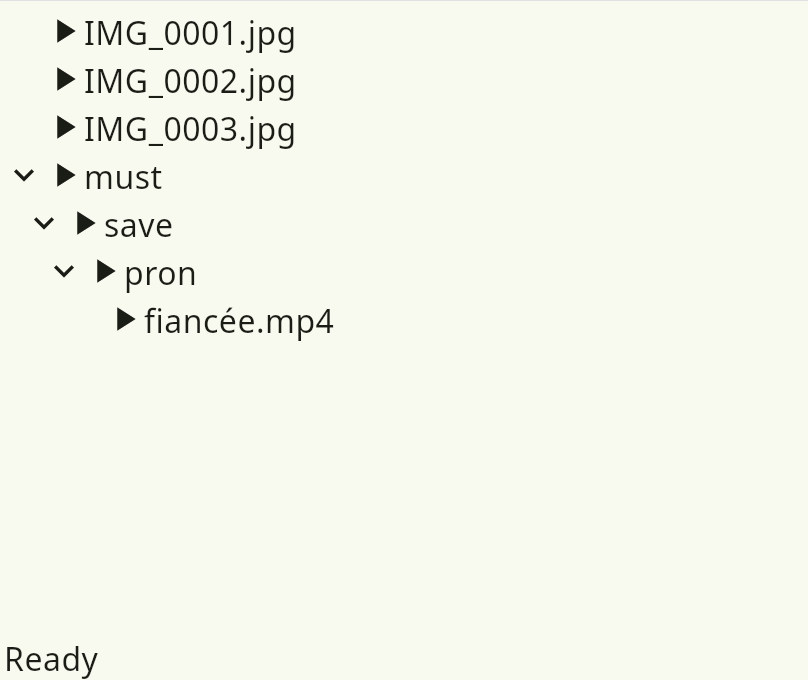

# Btrfs File Restorer

A GUI tool to restore files from damaged and unmountable btrfs filesystem

 

# Getting it
There are deb and rpm packages without any dependencies (e.g. suitable for any distro) at the release section.
So is a distro agnostic archive with built binaries.